<!--
File        : docs/evidence.md
Assignment  : DSO202 Assignment 4
Descriptor  : Unit IV 4.1 to 4.4 - GitOps with Argo CD
Purpose     : Command output and screenshots for every task, from the run of
              3 November 2026 against this repository on GitHub.
-->
# Evidence

All output below is from the real run. Text blocks are the evidence scripts'
saved output, with GitHub's push notices removed. Times are in Bhutan time (+06)
except Pod creation times, which are UTC. Deviations D1 to D5 are explained in
[`README.md`](../README.md#6-deviations-from-the-brief).

| Principle | Shown in |
|---|---|
| 1. Declarative | Tasks 3, 4, 5, 9: every object comes from a file in this repository |
| 2. Versioned and immutable | Tasks 2, 5, 7: pinned versions, a release is a commit, recovery is a revert |
| 3. Pulled automatically | Tasks 5, 7: merges reach dev with no `kubectl apply` or `argocd app sync` |
| 4. Continuously reconciled | Task 8: drift reverted in dev, reported in staging, removed files pruned |

## Task 1 - Repository, chart contract and cluster

`.gitignore` is the first commit (`440d657`). Both values files lint cleanly, and
the rendered kinds become the whitelist in Task 3. The Job in the kind list was
already on disk and was committed in Task 5.

```text
== tools
docker 29.7.2 | kind v0.32.0 | kubectl v1.36.1 | helm v4.3.0+gbec5b06
git version 2.50.1 (Apple Git-155) | argocd argocd: v3.5.6+c2b1e30.dirty | kubeseal version: 0.40.0

== pinned chart
chart 2.20.0 -> controller 0.40.0

== first commit
440d657 Add .gitignore before any other file
 .gitignore | 19 +++++++++++++++++++

== helm lint
dev: 1 chart(s) linted, 0 chart(s) failed
staging: 1 chart(s) linted, 0 chart(s) failed

== kinds rendered
   1 kind: ConfigMap
   3 kind: Deployment
   1 kind: Job
   1 kind: PersistentVolumeClaim
   3 kind: Service

== cluster
kind-dso202-gitops
control-plane Ready v1.36.1
worker-node-1 Ready v1.36.1
worker-node-2 Ready v1.36.1
dso202-gitops-control-plane 0.0.0.0:30080->30080/tcp, 127.0.0.1:57253->6443/tcp
```

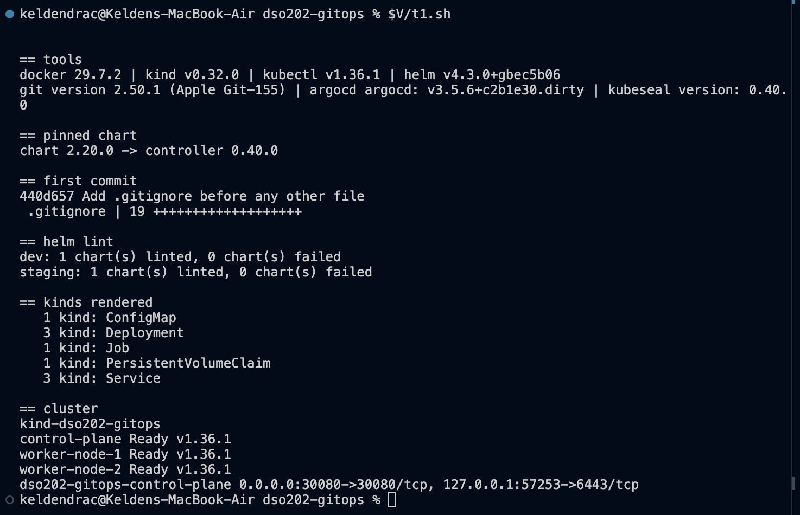

### Chart contract

| # | Requirement | Where it is satisfied |
|---|---|---|
| C1 | Image repository and tag are values | `values.yaml`: `image.registry`, `<tier>.image`, `<tier>.tag`, read through the `tasktracker.image` helper |
| C2 | A new variable is a values change | `<tier>.extraEnv` in `values.yaml`, rendered by a `range` in each tier template. A backend name that the ConfigMap also supplies is overridden through `hasKey` in `templates/backend.yaml` |
| C3 | No Secret is rendered | `existingSecret: tasktracker-credentials`, read by `secretKeyRef` in `templates/backend.yaml` and `templates/database.yaml` |
| C4 | Readiness probes on all tiers | `pg_isready` in `templates/database.yaml`, `GET /api/status` in `templates/backend.yaml`, `GET /` in `templates/frontend.yaml` |
| C5 | Sync waves 0, 1, 2 | `argocd.argoproj.io/sync-wave` annotations in the three tier templates |
| C6 | `progressDeadlineSeconds: 120` | `spec.progressDeadlineSeconds` in `templates/backend.yaml` and `templates/frontend.yaml` |
| C7 | Requests and limits on every container | `<tier>.resources` in `values.yaml`, and the smoke-test Job in `templates/smoke-test-job.yaml` |
| C8 | No platform objects in the chart | Kinds rendered: ConfigMap, Deployment, Job, PersistentVolumeClaim, Service |
| C9 | Any Ingress is off by default | The chart has no Ingress template |
| C10 | NodePort with the port as a value | `frontend.service.type` and `frontend.service.nodePort`: 30080 in `environments/dev/values.yaml`, 30081 in `environments/staging/values.yaml` |
| C11 | Lint and template succeed | The `helm lint` and `kinds rendered` sections above |

## Task 2 - Argo CD installed declaratively

Installed from `bootstrap/argocd` with server-side apply. The 7 workloads render
and run, and the local settings and the pinned version are in place.

```text
== render checks
   6 kind: Deployment
   1 kind: StatefulSet
  ghcr.io/dexidp/dex:v2.45.1
  public.ecr.aws/docker/library/redis:8.2.3-alpine
  quay.io/argoproj/argocd:v3.5.6

== pods
argocd-application-controller-0 1/1 Running
argocd-applicationset-controller-58bb5c7479-f444w 1/1 Running
argocd-dex-server-dd6b85d9c-lxcxd 1/1 Running
argocd-notifications-controller-6b85c65458-zm54k 1/1 Running
argocd-redis-869b85489d-xmtlf 1/1 Running
argocd-repo-server-5bf66565cd-n9bgh 1/1 Running
argocd-server-7474bb8f76-269gh 1/1 Running

== crds
applications.argoproj.io
applicationsets.argoproj.io
appprojects.argoproj.io

== argocd-cm
  accounts.reviewer: login
  timeout.reconciliation: 60s
  timeout.reconciliation.jitter: 10s

== version
argocd: v3.5.6+c2b1e30.dirty
argocd-server: v3.5.6
```

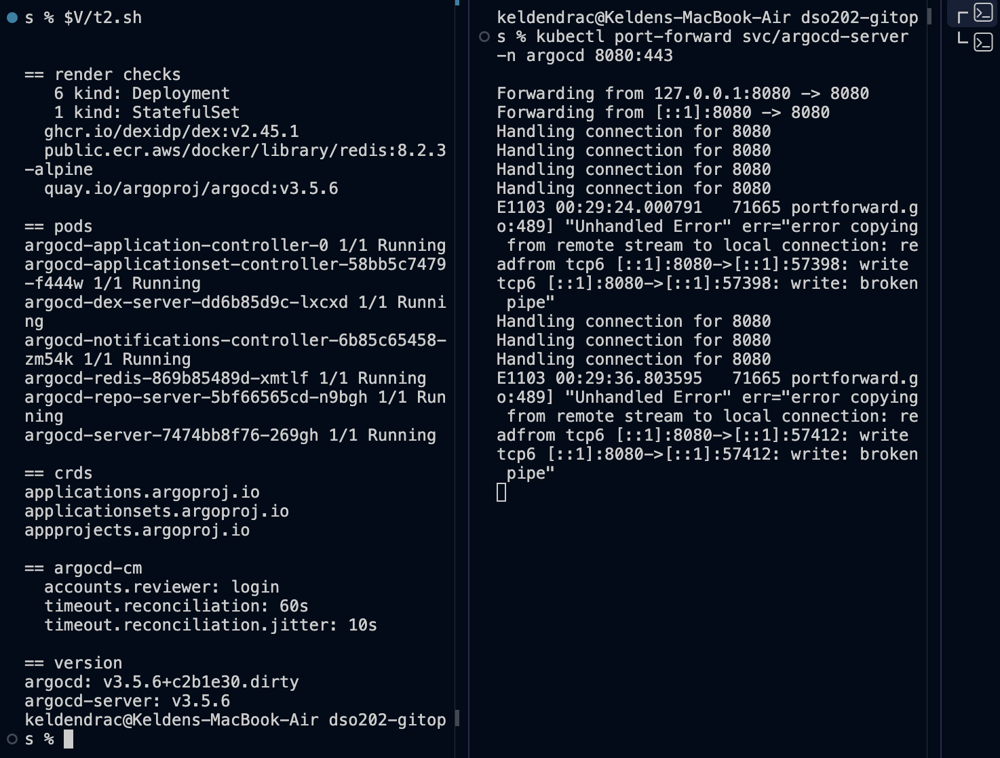

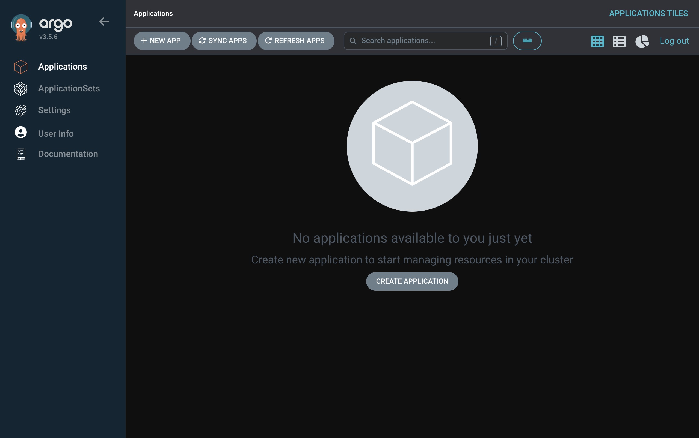

## Task 3 - AppProjects and the root Application

`dso202` was created by `root`, not by hand. At this stage the whitelist matched
the chart exactly. `ReplicaSet` and `Pod` were added later for Task 6 (D2). The
final whitelist is in `argocd/projects/dso202.yaml`, with a comment for each
addition.

```text
== projects and applications
default dso202 platform
root: Synced / Healthy @ d2e3bfc

== dso202 created by root
GROUP        KIND        NAMESPACE  NAME    ORPHANED
argoproj.io  AppProject  argocd     dso202  No

== dso202 project
Name:                        dso202
Destinations:                https://kubernetes.default.svc,dso202-dev
Allowed Cluster Resources:   <none>
Denied Namespaced Resources: <none>

== whitelist vs chart
identical: the whitelist names exactly the kinds the chart renders
```

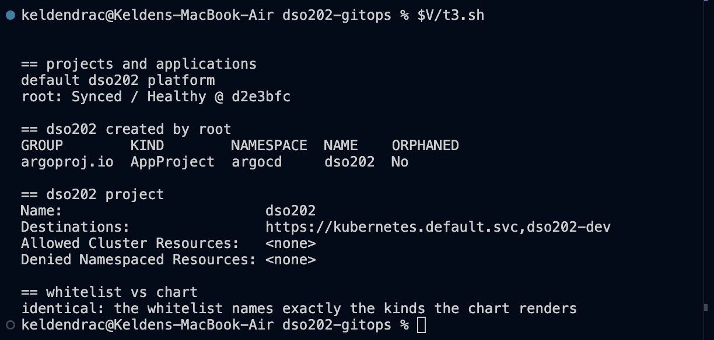

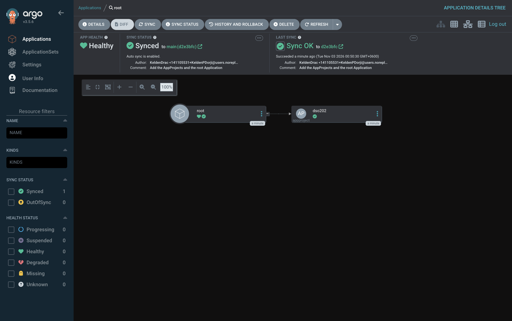

## Task 4 - Platform layer and Sealed Secrets

The controller and both platform Applications were delivered from Git. Each
Secret has its 4 keys, created by the controller. `describe` shows only sizes, and
the key backup is outside the repository with mode `600`.

```text
== applications
platform-dev: Synced / Healthy @ 7d9b1a4
platform-staging: Synced / Healthy @ 7d9b1a4
root: Synced / Healthy @ 7d9b1a4
sealed-secrets: Synced / Healthy @ 2.20.0

== namespaces
dso202-dev Active
dso202-staging Active

== dev
SealedSecret tasktracker-credentials synced=True
  DB_PASSWORD:        32 bytes
  DB_USER:            8 bytes
  POSTGRES_PASSWORD:  32 bytes
  POSTGRES_USER:      8 bytes
resourcequota/dso202-quota limitrange/dso202-limits

== staging
SealedSecret tasktracker-credentials synced=True
  DB_PASSWORD:        32 bytes
  DB_USER:            12 bytes
  POSTGRES_PASSWORD:  32 bytes
  POSTGRES_USER:      12 bytes
resourcequota/dso202-quota limitrange/dso202-limits

== key backup (outside the repo)
-rw------- sealing-key.backup.yaml
```

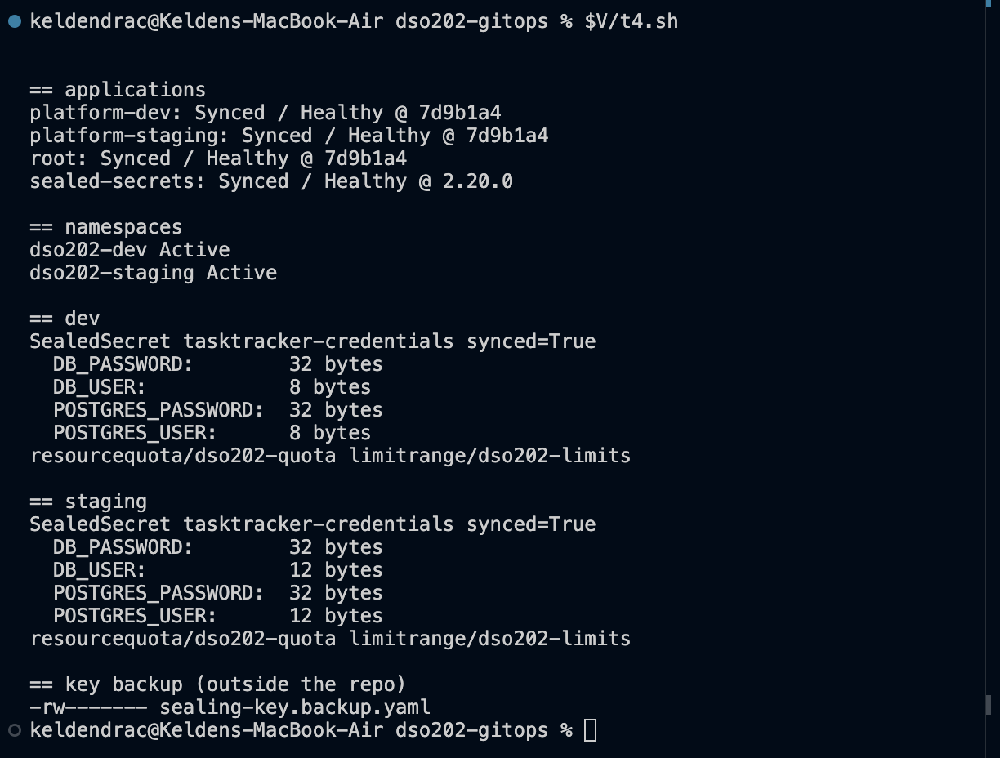

The committed files are ciphertext, and a search of the whole history for each
value returned nothing. Keys tested: `DB_USER`, `DB_PASSWORD`, `POSTGRES_USER` and
`POSTGRES_PASSWORD` for dev and staging. Values are never printed.

```text
== committed credential files are ciphertext
dev: kind=SealedSecret, encrypted keys=4
staging: kind=SealedSecret, encrypted keys=4

== history search across all branches (values are never printed)
dev DB_USER: 0 matching lines
dev DB_PASSWORD: 0 matching lines
dev POSTGRES_USER: 0 matching lines
dev POSTGRES_PASSWORD: 0 matching lines
staging DB_USER: 0 matching lines
staging DB_PASSWORD: 0 matching lines
staging POSTGRES_USER: 0 matching lines
staging POSTGRES_PASSWORD: 0 matching lines

== ignored by git
!! secrets-plain/
```

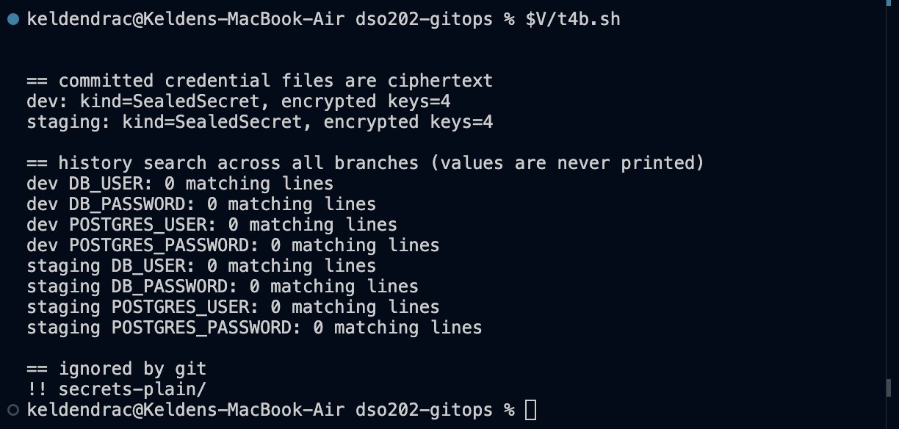

The search was repeated at the end of the run, at commit `4ef2756`, using the live
Secrets before the cluster was deleted. It covered the 8 keys, the base64 form of
each, and the sealing key. All 18 searches found no match in history or in the
working tree. The dev and staging passwords differ.

## Task 5 - Deliver the workloads

Pods started in wave order, then the PostSync smoke test ran. Staging waited at
the manual gate, `OutOfSync / Missing`, until a person synchronised it.

```text
== pod creation order (waves 0,1,2 then PostSync)
tasktracker-db-6654dd5b7d-k9gt4        2026-11-02T18:54:50Z   Running
tasktracker-backend-d84b5b9f-7h4rl     2026-11-02T18:55:21Z   Running
tasktracker-frontend-57b68d795-7zg4g   2026-11-02T18:55:43Z   Running
tasktracker-smoke-test-4z8j7           2026-11-02T18:56:00Z   Succeeded

== smoke test
tasktracker-smoke-test Complete 1/1
log: "3 tasks returned from the database"

== dev
Project:            dso202
Sync Policy:        Automated (Prune)
Sync Status:        Synced to main (e5c55a2)
Health Status:      Healthy

== staging before first sync
Sync Policy:        Manual
Sync Status:        OutOfSync from v1.0.0 (7a1bcf4)
Health Status:      Missing

== root before first staging sync
root: Synced / Healthy @ e5c55a2
```

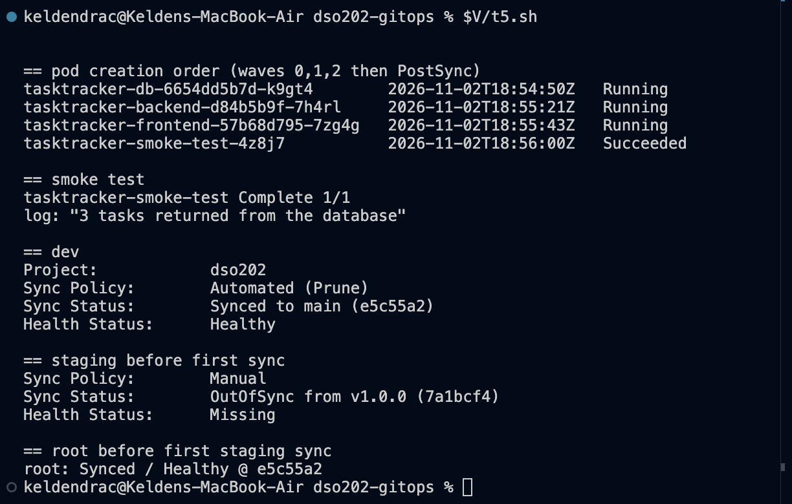

The tree below was taken before the D2 change, so it shows no Pods. After that
change the tree shows them, and screenshot 13 shows a Pod's logs.

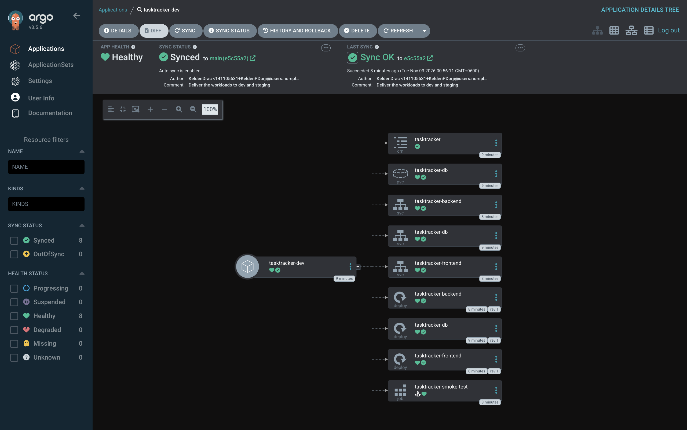

CRUD ran against the API through a port-forward (D4). Then staging was
synchronised by hand, leaving all Applications Synced and Healthy. `root` read
`Synced / Healthy` both before and after the first staging sync, where the brief
expects it not to be Healthy before (D3).

```text
== CRUD in dev, through a port-forwarded backend
POST   -> {"id":4,"title":"GitOps CRUD","status":"pending"}
GET    -> [1,2,3,4]
PUT    -> {"id":4,"status":"done"}
DELETE -> HTTP 204
GET    -> [1,2,3]

== frontend
dev  http://localhost:30080 -> HTTP 200

== staging sync (the manual gate)
Sync Status:        Synced to v1.0.0 (7a1bcf4)
Health Status:      Healthy
Phase:              Succeeded
staging port-forward -> HTTP 200

== after staging sync
platform-dev: Synced / Healthy @ e5c55a2
platform-staging: Synced / Healthy @ e5c55a2
root: Synced / Healthy @ e5c55a2
sealed-secrets: Synced / Healthy @ 2.20.0
tasktracker-dev: Synced / Healthy @ e5c55a2
tasktracker-staging: Synced / Healthy @ 7a1bcf4
tasktracker-frontend NodePort 8080:30081/TCP
```

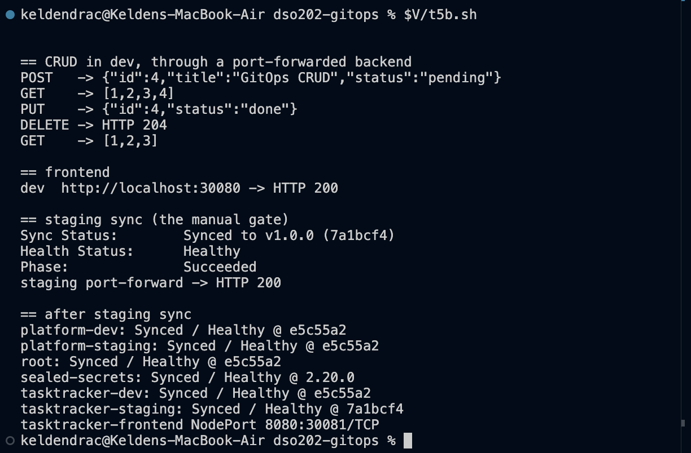

## Task 6 - Access control

Before the logs rule, `reviewer` sees only the 2 `dso202` Applications, can read
them, cannot sync, cannot read logs, and is denied the `platform` project.

```text
== accounts
NAME      ENABLED  CAPABILITIES
admin     true     login
reviewer  true     login

== reviewer sees
argocd/tasktracker-dev
argocd/tasktracker-staging

== reviewer permissions
get applications: yes
sync applications: no
get logs: no
proj get platform: PermissionDenied desc = permission denied: projects, get, platform
```

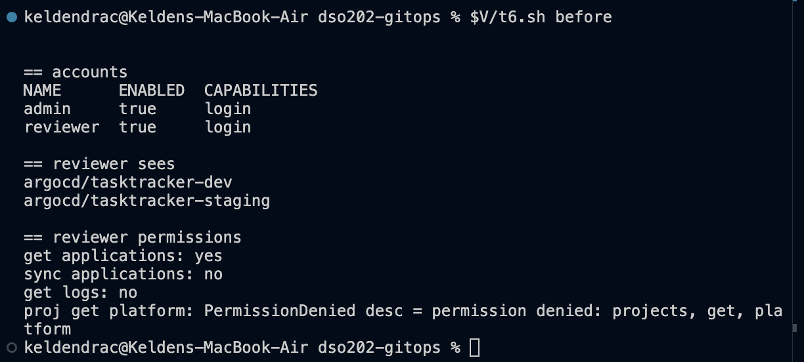

The rule was enabled by commit `4c5ce3e` and applied with the bootstrap command,
as `bootstrap/` is not delivered by Argo CD.

```text
== after enabling the logs rule by commit
4c5ce3e Grant reviewer read access to logs
21:    p, reviewer, applications, get, dso202/*, allow
22:    p, reviewer, projects, get, dso202, allow
27:    p, reviewer, logs, get, dso202/*, allow
get logs: yes
```

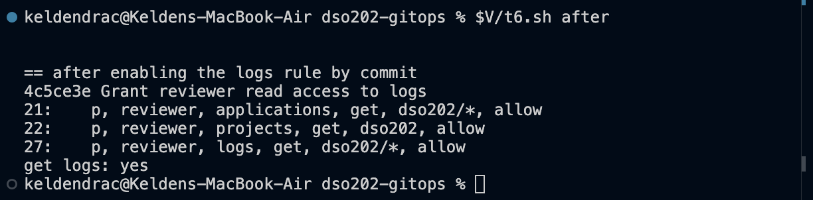

`can-i` answered yes, but the Logs tab was still missing, because the project
whitelist hid the Pods from Argo CD. `argocd app logs` returned nothing even for
`admin`. Commit `4a71fc6` added `ReplicaSet` and `Pod` (D2). The `reviewer` CLI
context then returned the backend log:

```text
[db] connected
[server] listening on :8080
```

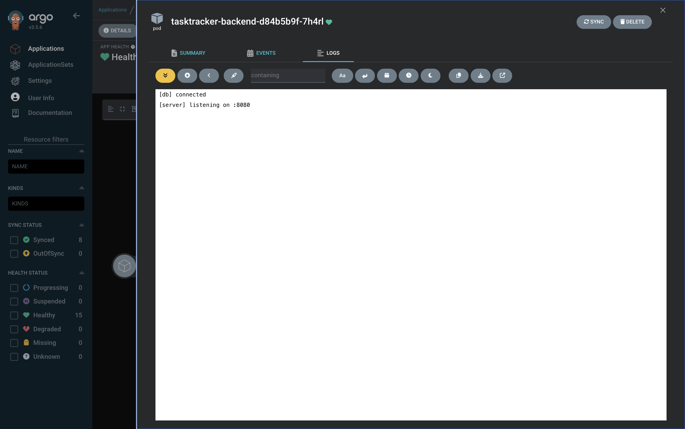

The screenshot was taken in the private window signed in as `reviewer`. The Argo
CD UI does not show the signed-in user on this panel, and the server log records
the sign-in but not the user behind each log request. `reviewer` was also limited
to `dso202`: `can-i get logs platform/platform-dev` still answered no.

## Task 7 - A release, a faulty release, and recovery

Every change went through a pull request and was squash-merged. Because the `1.1`
images do not exist on Docker Hub, the releases are configuration changes (D1).

### Part A - Frontend release and promotion

Dev rolled to a new ReplicaSet within a minute of the merge, with no `kubectl
apply` and no `argocd app sync`, and the smoke test ran again. Staging stayed on
`v1.0.0`.

```text
== before
dev frontend RS: tasktracker-frontend-57b68d795  RELEASE=unset
tasktracker-staging: Synced / Healthy @ 7a1bcf4

== dev after the merge (no kubectl apply, no argocd sync)
commit: 7ed2dd7 Release 1.1: frontend configuration (#1)
dev frontend RS: tasktracker-frontend-d6db658f  RELEASE=1.1
tasktracker-dev: Synced / Healthy @ 7ed2dd7
smoke test: tasktracker-smoke-test Complete

== staging is untouched: it reads tag v1.0.0
tasktracker-staging: Synced / Healthy @ 7a1bcf4
staging frontend RELEASE=unset

== dev history
SOURCE  https://github.com/KeldenPDorji/dso202-gitops.git
ID      DATE                           REVISION
0       2026-11-03 00:56:11 +0600 +06  main (e5c55a2)
1       2026-11-03 01:33:10 +0600 +06  main (7ed2dd7)
```

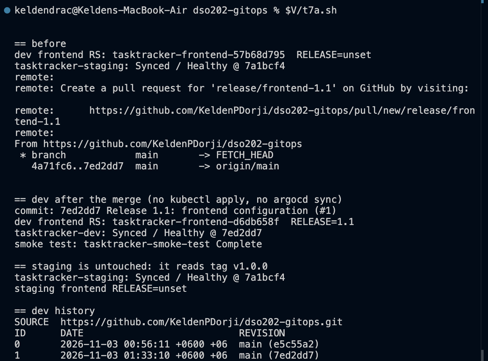

After the tag and the promotion pull request, staging became `OutOfSync` but
deployed nothing until a person synchronised it.

```text
== pull request moves the gate to v1.1.0
197f779 Promote staging to v1.1.0 (#2)

== merged, but nothing deployed: staging waits for a person
tasktracker-staging: OutOfSync / Healthy @ 7ed2dd7
frontend RELEASE=unset backend RELEASE=unset

== manual sync
Sync Status:        Synced to v1.1.0 (7ed2dd7)
Health Status:      Healthy
Phase:              Succeeded

== after
tasktracker-staging: Synced / Healthy @ 7ed2dd7
frontend RELEASE=1.1 backend RELEASE=unset
```

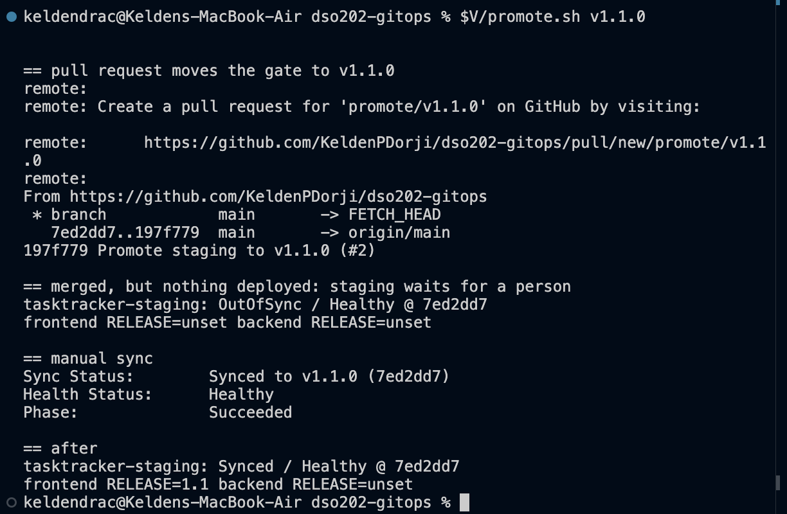

### Part B - Faulty release, recovery and fix-forward

PR #3 set `DB_HOST` to a name with no Service. The bad commit is `b62f699`. The
new Pod never became ready, dev became `Synced / Degraded` once the 120-second
deadline passed, and the old Pod kept serving. The smoke test did not run and
staging was unaffected. The log gave the cause, and rollback was refused.

```text
== bad commit
b62f699 Release 1.2: backend configuration (#3)

== observed, without intervening
tasktracker-backend-95c8f7fd5-njfvj 0/1 Running
tasktracker-backend-d84b5b9f-7h4rl 1/1 Running
tasktracker-dev: Synced / Degraded @ b62f699
tasktracker-staging: Synced / Healthy @ 7ed2dd7
smoke test for this revision: did not run: the sync never reached PostSync
old Pod still serving: {"status":"ok","db":"connected"}

== diagnosis
DB_HOST:      tasktracker-database
Warning  Unhealthy  3s (x24 over 114s)  kubelet            spec.containers{backend}: Readiness p
log: [db] not reachable yet (ENOTFOUND), retrying in 2000ms

== argocd app rollback
rpc error: code = FailedPrecondition desc = rollback cannot be initiated when auto-sync is enabled
```

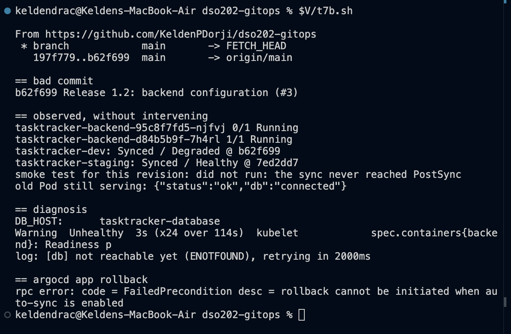

The revert merged as PR #4 at 02:01:16, and dev reached `dc6bca8` at 02:02:45.
Both the bad commit and its revert stay in history.

```text
== revert merged
dc6bca8 Revert "Release 1.2: backend configuration (#3)" (#4)
b62f699 Release 1.2: backend configuration (#3)
Argo CD finishes retrying the failed sync first, so this can take several minutes

== dev after the revert
tasktracker-dev: Synced / Healthy @ dc6bca8
tasktracker-backend-95c8f7fd5-njfvj 0/1 Terminating
tasktracker-backend-d84b5b9f-7h4rl 1/1 Running
api: {"status":"ok","db":"connected"}

== the bad commit is still in history
dc6bca8 Revert "Release 1.2: backend configuration (#3)" (#4)
b62f699 Release 1.2: backend configuration (#3)
197f779 Promote staging to v1.1.0 (#2)
7ed2dd7 Release 1.1: frontend configuration (#1)
```

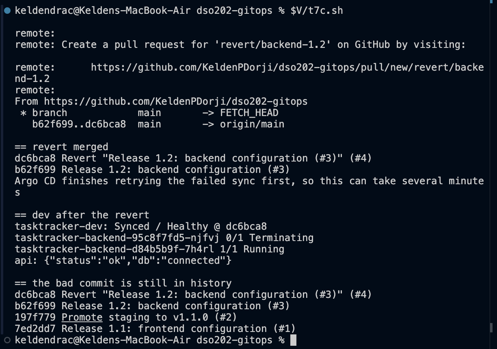

The fix-forward set the correct value through `extraEnv` (C2), with no template
change. It was then tagged `v1.2.0` and promoted through the same gate.

```text
== fix-forward in dev
7616313 Release 1.2: backend, DB_HOST corrected (#5)
tasktracker-dev: Synced / Healthy @ 7616313
backend RELEASE=1.2 DB_HOST=tasktracker-db
smoke test: tasktracker-smoke-test Complete
```

```text
== pull request moves the gate to v1.2.0
68cb2bb Promote staging to v1.2.0 (#6)

== merged, but nothing deployed: staging waits for a person
tasktracker-staging: OutOfSync / Healthy @ 7616313
frontend RELEASE=1.1 backend RELEASE=unset

== manual sync
Sync Status:        Synced to v1.2.0 (7616313)
Health Status:      Healthy
Phase:              Succeeded

== after
tasktracker-staging: Synced / Healthy @ 7616313
frontend RELEASE=1.1 backend RELEASE=1.2
```

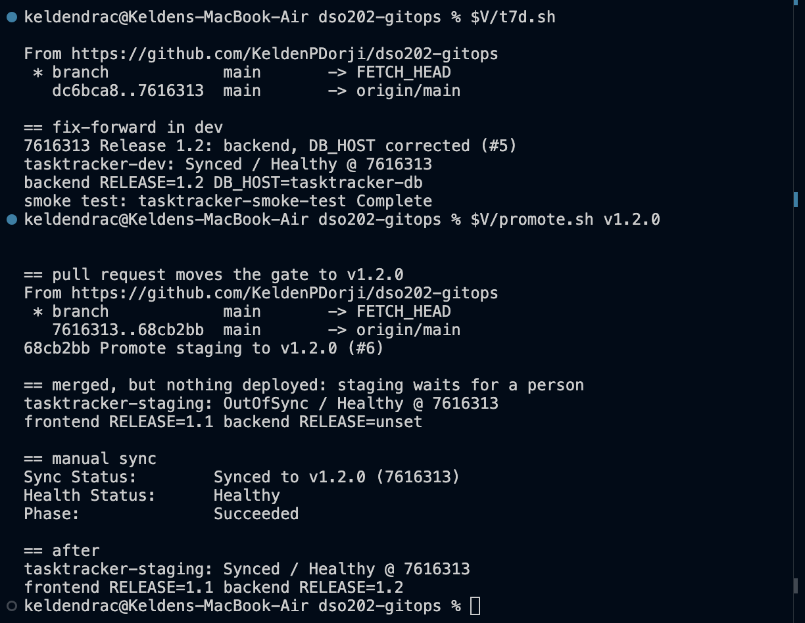

The pull request list, graph and histories follow. `b62f699` is absent from the
staging history. It is also absent from the dev history, because Argo CD records
only successful syncs there.

```text
== pull requests
#1 Release 1.1: frontend configuration
#2 Promote staging to v1.1.0
#3 Release 1.2: backend configuration
#4 Revert release 1.2: backend
#5 Release 1.2: backend, DB_HOST corrected
#6 Promote staging to v1.2.0

== graph
* 68cb2bb (HEAD -> main, origin/main) Promote staging to v1.2.0 (#6)
* 7616313 (tag: v1.2.0) Release 1.2: backend, DB_HOST corrected (#5)
* dc6bca8 Revert "Release 1.2: backend configuration (#3)" (#4)
* b62f699 Release 1.2: backend configuration (#3)
* 197f779 Promote staging to v1.1.0 (#2)
* 7ed2dd7 (tag: v1.1.0) Release 1.1: frontend configuration (#1)
* 4a71fc6 Permit ReplicaSet and Pod so Argo CD can show Pod logs
* 4c5ce3e Grant reviewer read access to logs
* e5c55a2 Deliver the workloads to dev and staging
* 7a1bcf4 (tag: v1.0.0) Add the PostSync smoke test
* 7d9b1a4 Deliver the platform layer and sealed credentials
* 4c8e8f7 Install the Sealed Secrets controller through Git
* d2e3bfc Add the AppProjects and the root Application
* d8f2226 Add the pinned Argo CD installation
* d7f27b7 Add the Task Tracker chart and environment values

== staging history
ID      DATE                           REVISION
0       2026-11-03 01:05:29 +0600 +06  v1.0.0 (7a1bcf4)
1       2026-11-03 01:37:20 +0600 +06  v1.1.0 (7ed2dd7)
2       2026-11-03 02:04:50 +0600 +06  v1.2.0 (7616313)

== dev history
0       2026-11-03 00:56:11 +0600 +06  main (e5c55a2)
1       2026-11-03 01:33:10 +0600 +06  main (7ed2dd7)
2       2026-11-03 02:02:45 +0600 +06  main (dc6bca8)
3       2026-11-03 02:03:57 +0600 +06  main (7616313)

== staging never ran the faulty commit
b62f699 is absent from the staging history
```

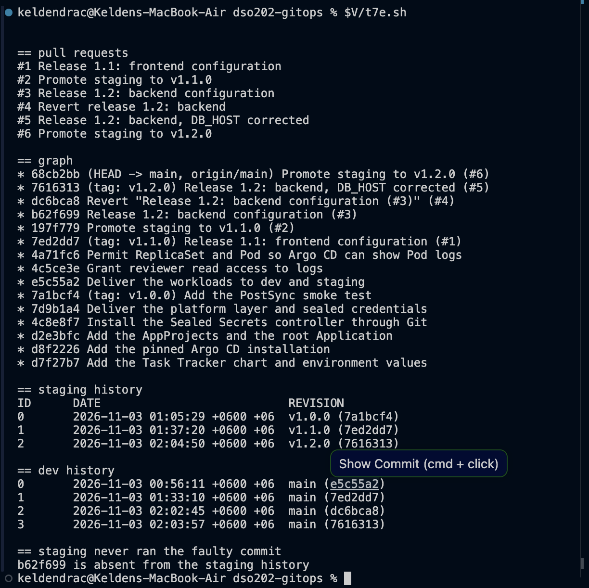

## Task 8 - Drift, pruning and project guardrails

### Drills 1 and 2

Commands: `kubectl scale deployment/tasktracker-backend -n dso202-dev --replicas=3`,
then the same in `dso202-staging`, followed by `argocd app diff tasktracker-staging`
and `argocd app sync tasktracker-staging`.

| Drill | Prediction | Held? | Explanation |
|---|---|---|---|
| 1. Drift in dev | Self-heal returns dev to 1 replica without anyone acting | Yes | `selfHeal: true` restored `spec.replicas` immediately, before the extra Pods became ready. The elapsed time printed as 0s because the script's wait began after the scale command returned. Principle 4 |
| 2. Drift in staging | Staging is reported OutOfSync but stays at 3 replicas until synced | Yes | Staging has no `automated` block, so Argo CD detects and reports drift and changes nothing until a person syncs |

```text
== drill 1: prediction: self-heal returns dev to 1 replica without anyone acting
tasktracker-backend   1/1   1     1     70m
deployment.apps/tasktracker-backend scaled
tasktracker-backend   1/3   1     1     70m
tasktracker-backend   1/3   1     1     70m
tasktracker-backend   1/3   1     1     70m
tasktracker-backend   1/3   3     1     70m
tasktracker-backend   1/1   3     1     70m
reverted to spec.replicas=1 after 0s
tasktracker-dev: Synced / Healthy @ 68cb2bb

== drill 2: prediction: staging is reported OutOfSync but stays at 3 replicas until synced
deployment.apps/tasktracker-backend scaled
tasktracker-staging: OutOfSync / Progressing @ 7616313
live replicas: 3
===== apps/Deployment dso202-staging/tasktracker-backend ======
<   replicas: 3
>   replicas: 1
Sync Status:        Synced to v1.2.0 (7616313)
Phase:              Succeeded
live replicas after sync: 1
tasktracker-staging: Synced / Healthy @ 7616313
```

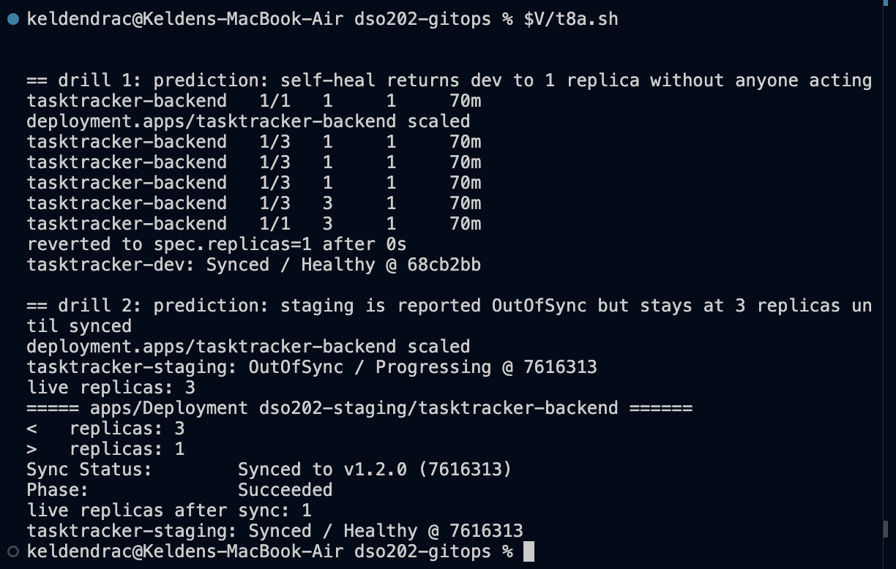

### Drills 3 and 4

Commands: drill 3 added Listing 16 as `platform/dev/prune-drill.yaml`, committed and
pushed it, then ran `git rm`, committed and pushed. Drill 4 added Listing 17 as
`charts/tasktracker/templates/drill-quota.yaml`, committed and pushed it, then ran
`git revert` on that commit and pushed.

| Drill | Prediction | Held? | Explanation |
|---|---|---|---|
| 3. Removing a file | Deleting the file from Git deletes the ConfigMap from the cluster | Yes | `prune: true` removes objects that no longer exist in Git. The `Prune=false` annotation on the namespace manifest is what protects the namespace from the same behaviour. That protection was not tested, as the brief instructs |
| 4. Project guardrail | Project `dso202` refuses the ResourceQuota, and staging is unaffected | Yes | ResourceQuota is not on the whitelist, so the sync was refused and nothing was created. Staging reads tag `v1.2.0`, which does not contain the file. Reverting restored dev |

These two drills were pushed straight to `main`, as the brief instructs.

Drill 4 shows a script timeout. After the revert, the script waited for a new sync
of `4ef2756`. None was needed: the ResourceQuota was never applied, so dev already
matched Git as soon as Argo CD read the revert. The last recorded operation stays
`Failed @ 5fe500a`, and that is why the wait could not finish. The cluster was
never in a bad state. The script was corrected, and the `restored by git revert`
section was added from the same cluster without repeating the drills.

```text
== drill 3: prediction: deleting the file from Git deletes the ConfigMap from the cluster
present: prune-drill
Error from server (NotFound): configmaps "prune-drill" not found

== drill 4: prediction: project dso202 refuses the ResourceQuota, and staging is unaffected
tasktracker-dev: OutOfSync / Healthy @ 5fe500a
message: one or more synchronization tasks are not valid: resource :ResourceQuota is not permitted in pro
tasktracker-staging: Synced / Healthy @ 7616313
drill-quota in cluster: 0
error: timed out waiting for the condition on applications/tasktracker-dev

== restored by git revert
4ef2756 Revert "Drill 4: add ResourceQuota to the chart"
tasktracker-dev: Synced / Healthy @ 4ef2756
drill-quota in cluster: 0
last sync operation: Failed @ 5fe500a
full refusal: resource :ResourceQuota is not permitted in project dso202 (retried 5 times).
note: the timeout above is the script's own wait. The ResourceQuota was never
applied, so after the revert dev already matched Git and no new sync ran.
```

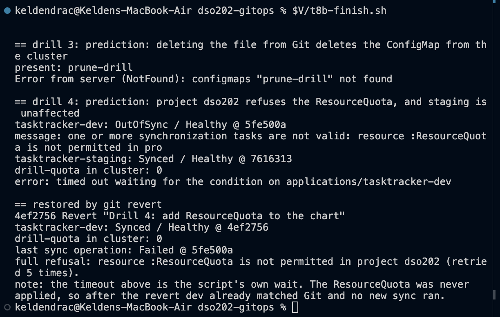

## Task 9 - Rebuild from Git

The cluster was deleted and rebuilt from this repository and the backed-up key.
The platform Applications could only become Healthy with the restored key
decrypting the SealedSecrets, so that step proves the restore.

| Measure | Result |
|---|---|
| `kind create cluster` to a working dev frontend | 212 seconds |
| `kind create cluster` to staging synchronised | 282 seconds |
| Whole run, from `date` to `date` | 02:34:13 to 02:38:58 |
| Staging tag before and after | `7616313` (`v1.2.0`) |

```text
== before
HEAD 4ef2756
platform-dev: Synced / Healthy @ 4ef2756
platform-staging: Synced / Healthy @ 4ef2756
root: Synced / Healthy @ 4ef2756
sealed-secrets: Synced / Healthy @ 2.20.0
tasktracker-dev: Synced / Healthy @ 4ef2756
tasktracker-staging: Synced / Healthy @ 7616313

== rebuild
Tue Nov  3 02:34:13 +06 2026
+33s  cluster ready
+33s  sealing key restored before the controller exists
+113s  Argo CD ready
+113s  root applied
+133s  wave -2: sealed-secrets
+135s  wave -1: platform-dev (restored key decrypted its SealedSecret)
+135s  wave -1: platform-staging (restored key decrypted its SealedSecret)
+212s  wave 0: tasktracker-dev
dev frontend -> HTTP 200
+212s  working dev frontend
Sync Status:        Synced to v1.2.0 (7616313)
+282s  staging synced by hand

== after
platform-dev: Synced / Healthy @ 4ef2756
platform-staging: Synced / Healthy @ 4ef2756
root: Synced / Healthy @ 4ef2756
sealed-secrets: Synced / Healthy @ 2.20.0
tasktracker-dev: Synced / Healthy @ 4ef2756
tasktracker-staging: Synced / Healthy @ 7616313
dev new task: {"id":4,"title":"after rebuild"}
staging new task: {"id":4,"title":"after rebuild"}
fresh backup: -rw------- sealing-key.backup.yaml
Tue Nov  3 02:38:58 +06 2026
```

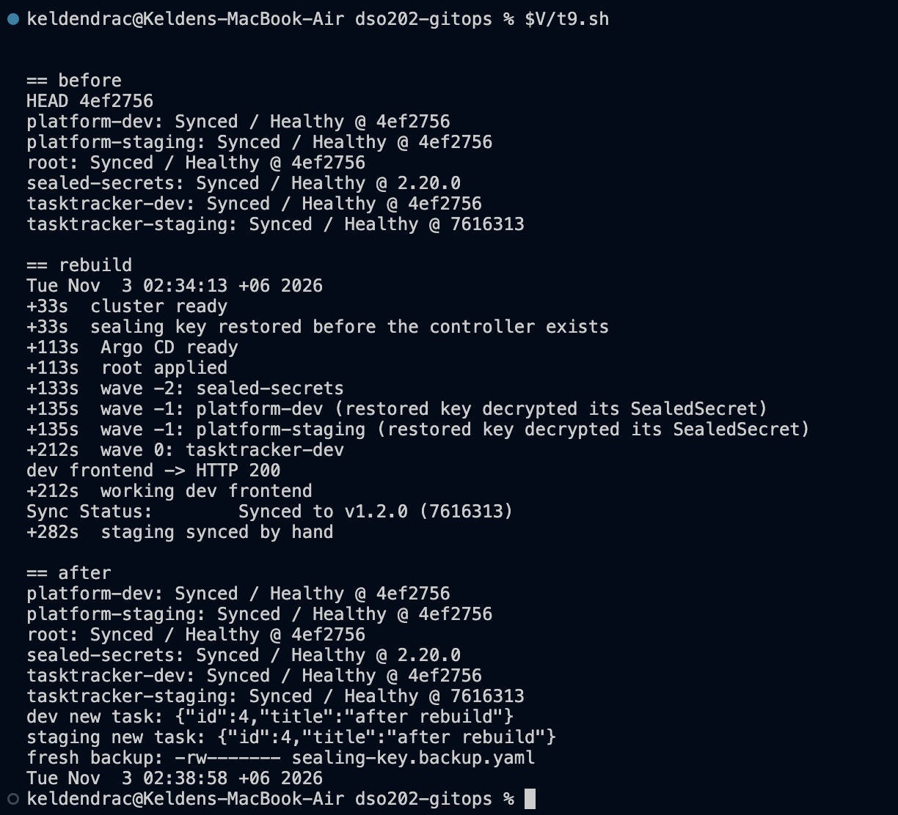

The new task is ID 4 in both environments because the rebuilt databases hold only
the 3 seeded tasks. Database contents are not in Git, which is the data loss the
brief expects.
